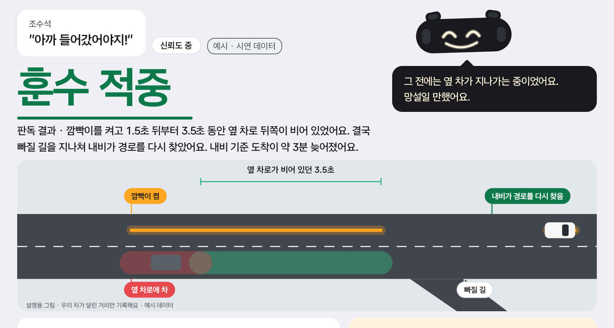
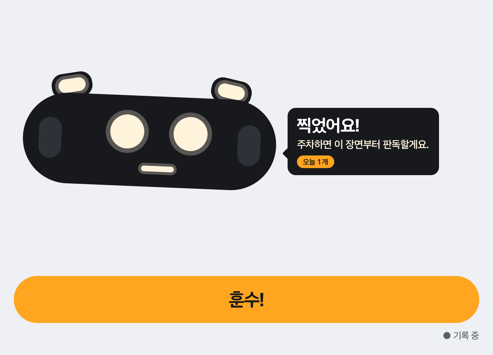
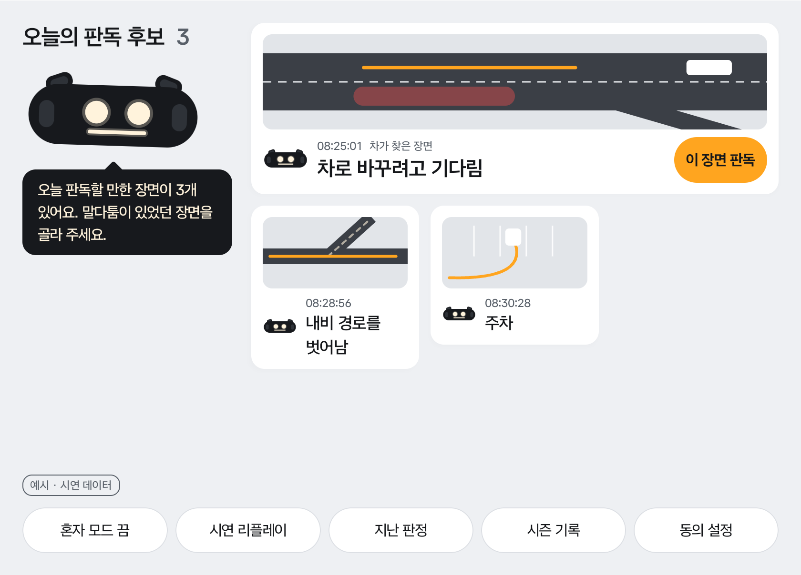
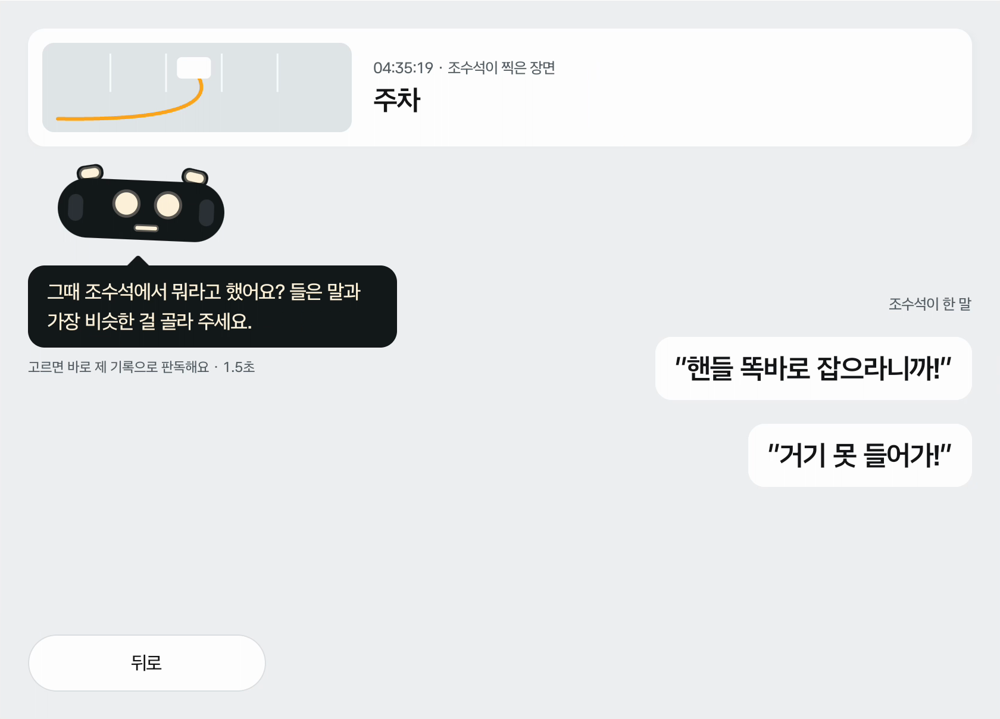
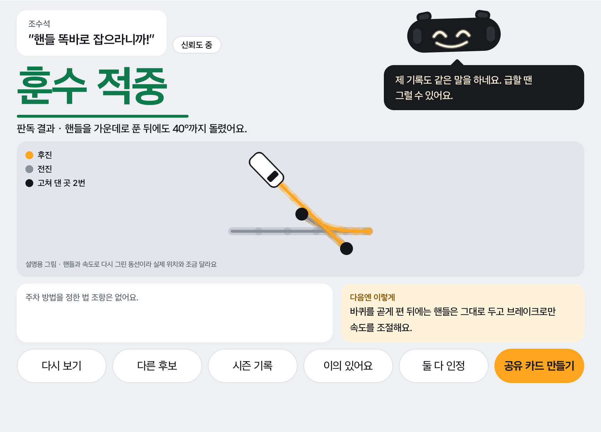
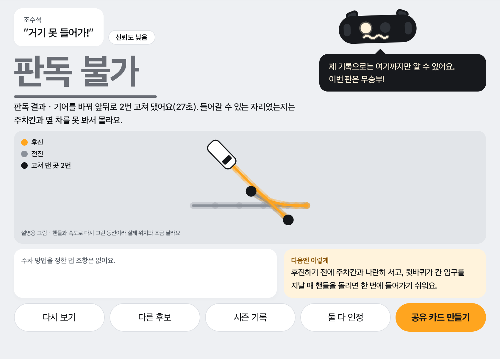
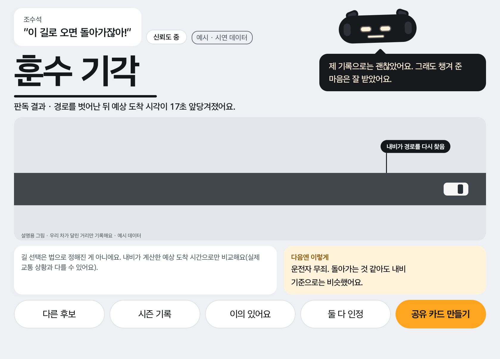
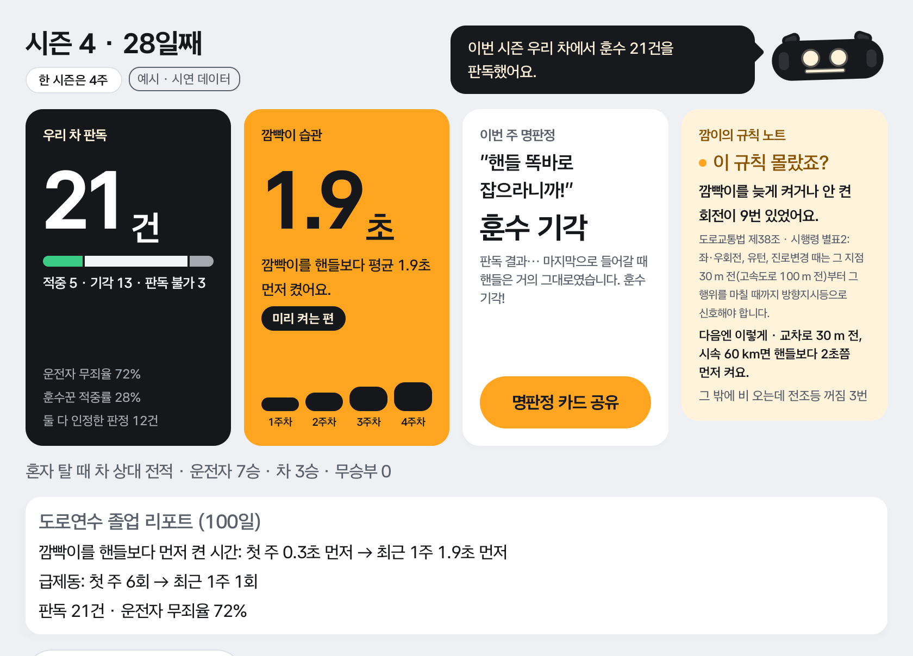

# 훈수 VAR

> **운전석 vs 조수석, 심판은 차.** Vehicle Assistant Referee.

조수석에서 한 훈수가 맞았는지 차 기록으로 판정하는 Pleos Connect 앱입니다. 판정하는 훈수는 차 안 말다툼이 가장 잦은 세 장면, 끼어들기("아까 들어갔어야지!"), 주차("핸들 똑바로 잡으라니까!"), 길 선택("이 길로 오면 돌아가잖아!")입니다. 근거로는 방향지시등·조향각·기어·차속·후측방 경고와 내비 경로를 씁니다. 달리는 동안에는 기록만 하고, 주차(P)하면 장면을 다시 그려 결과를 보여 줍니다. 끼어들기 장면에서 조수석이 '훈수!'를 눌렀다면 신호 대기로 멈췄을 때 결과를 한 줄 먼저 보여 줍니다.



*Pleos Connect 에뮬레이터에서 띄운 앱 화면입니다. 에뮬레이터로는 내비 값과 후측방 경고를 만들 수 없어서 앱에 넣어 둔 시연 주행으로 판정했습니다. 깜빡이를 켜고 1.5초 동안은 옆 차가 있었고, 그 뒤 3.5초 동안 옆 차로 뒤쪽이 비어 있었습니다(초록 띠). 그래서 "아까 들어갔어야지!"는 훈수 적중입니다. 판독관 깜이(차 앞 램프 얼굴)는 결과를 설명하고 진 쪽 사정을 챙깁니다.*

## 한눈에

- **시연 영상 (1분)**: [docs/media/demo.mp4](docs/media/demo.mp4). 끼어들기 말다툼과 판정(시연 주행) → 조수석 훈수 통계 → 에뮬레이터에 신호를 넣어 달리고 주차(후진하면 시스템 주차 카메라가 켜짐) → “핸들 똑바로 잡으라니까!” 적중(마지막 후진 때 핸들 40°) → 다른 결과 두 가지(길 선택 기각, “거기 못 들어가!” 판독 불가) → 판독에 쓰는 차 기록과 이 앱을 쓸 수 있는 차. 배경음악: “Life of Riley” Kevin MacLeod (incompetech.com), CC BY 4.0.
- **APK**: [apk/HunsuVAR_훈수VAR_release.apk](apk/) (릴리즈, 서명 완료). 설치와 신호 넣는 법은 아래 [실행 방법](#실행-방법)에 있습니다.
- **판정 로직 테스트**: `./gradlew :core:test`로 돌립니다. Android SDK가 없어도 됩니다.

| 주행 중 (훈수! 누름) | 판독 후보 | 훈수 고르기 | 주차 · 적중 | 주차 · 판독 불가 | 길 선택 · 기각 | 시즌 기록 |
|---|---|---|---|---|---|---|
|  |  |  |  |  |  |  |

## 무엇을 판정하나

한국 커뮤니티·기사에 올라온 차 안 말다툼 33건을 보면 끼어들기·차선 변경이 13개, 주차가 8개, 길 선택이 3개였습니다. 속도·안전벨트·전조등 지적은 대부분 규칙을 알려 주는 잔소리에 가까웠습니다. 그래서 조수석 판독 후보에는 이 세 장면만 올립니다. 판정에는 두 사람의 기억이 엇갈리는 사실 가운데 차가 기록한 것만 씁니다.

| 장면 | 앱이 장면을 찾는 방법 | 훈수와 결과 |
|---|---|---|
| 끼어들기 · 빠질 길 | 시속 10 km 이상으로 달리며 깜빡이를 3초 이상 켜고, 핸들은 90° 미만. 깜빡이 쪽 후측방 경고 값이 있거나, 내비의 다음 안내가 1 km 안의 깜빡이 쪽 출구·분기·회전일 때만 올립니다(터널·톨게이트·직진 안내는 빼요). 장면이 끝나고 5분 안에 누른 훈수까지 이 장면에 붙습니다 | "아까 들어갔어야지!": 늦게라도 빠질 길로 빠졌으면(내비가 다음 안내로 넘어감) 기각. 아니면, 깜빡이를 켠 뒤 핸들이 그때보다 3° 이상 움직여 들어가기 시작할 때까지 깜빡이 쪽 후측방 경고가 3초 이상 꺼져 있던 틈(시속 20 km 이상)이 있었으면 적중(신뢰도 중). 그런 틈 없이 바로 들어갔고 길도 놓치지 않았으면 기각("틈이 나자 바로 들어갔습니다"), 가장 긴 틈이 3초가 안 되면 기각. 경고 기록이 없거나, 한 번도 안 켜졌거나, 대부분 시속 20 km 미만이었으면 판독 불가. 길을 놓쳤으면 내비 기준으로 늦어진 도착 시간도 보여 줍니다. "차! 차!": 깜빡이 쪽 후측방 경고가 켜진 채 핸들을 5° 이상 꺾었으면 적중, 아니면 판독 불가 |
| 주차 | 마지막으로 시속 15 km 이상으로 3초 이상 달린 뒤부터 기어 P까지(최대 5분). 주차하는 동안 누른 훈수가 붙습니다 | "핸들 똑바로 잡으라니까!": 마지막 이동에서 핸들을 가운데(15° 안)로 푼 뒤 다시 30° 이상 돌렸으면 적중, 아니면 기각. 가운데로 푼 적이 없으면 판독 불가. "거기 못 들어가!": 앞뒤로 고쳐 댄 적이 없으면 기각. 고쳐 댔으면 횟수와 걸린 시간을 보여 주고 판독 불가(들어갈 수 있는 자리였는지는 주차칸을 못 봐서 몰라요), 주차 요령을 덧붙입니다 |
| 길 선택 | 내비 경로 재탐색(빠질 길 장면에서 생긴 재탐색은 빼요). 10분 안에 누른 훈수까지 붙습니다 | "이 길로 오면 돌아가잖아!": 경로를 벗어나기 전과 다시 찾은 뒤의 내비 예상 도착 시각을 비교해 1분 이상 늦어졌으면 적중, 아니면 기각(같으면 "도착 시간이 같았습니다") |

- **판독 불가로 두는 것**: 앞차와의 거리, 노란불, 주차선·옆 차와의 거리, 끼어들 틈의 거리(m), 앞쪽 옆 차, 시속 20 km 미만 정체 속 끼어들기(후측방 경고가 작동하지 않음). 주차 카메라는 차에 있지만 시스템 앱만 쓸 수 있어서 일반 앱이 읽을 API가 없습니다.
- **깜이의 규칙 노트(판정 아님)**: 회전 깜빡이 30 m 기준, 제한속도보다 시속 10 km 이상 빠르게 3초 이상, 비 올 때 전조등 꺼짐 30초, 안전벨트 미착용 3초는 따로 기록만 해 둡니다. 시즌 기록에서 자주 놓친 것부터 법 조항과 요령을 알려 줍니다.
- **혼자 모드**: 동승자 없이 탈 때 쓰는 모드입니다. 주행 중에는 '훈수!' 버튼 대신 "혼자 모드예요. 주차하면 제가 장면을 찾아 훈수를 둘게요."라는 안내만 나오고, 주차하면 회전 깜빡이·과속·브레이크·비 올 때 전조등 같은 규칙 판정을 연습용으로 보여 줍니다.

## 화면

- **말풍선**: 사람이 한 말은 흰 말풍선, 깜이의 말은 깜이 몸과 같은 검은 말풍선(#17191D, 글자 #FFF3DC)입니다. 결과는 판정 단어와 그림으로 보여 주고, 깜이는 장면 소개와 설명, 진 쪽 챙기기("그래도 챙겨 준 마음은 잘 받았어요")만 합니다.
- **주행 중**: 깜이와 큰 **'훈수!'** 버튼만 나옵니다. 누르면 깜이가 조수석 쪽을 보며 "찍었어요!"라고 답합니다. 끼어들기 장면에서 누른 훈수는 차가 멈췄을 때(차속을 받고 있고 시속 1 km 미만) 같은 말풍선에 "“아까 들어갔어야지!” 판독 결과", 판정 단어, "자세한 건 주차하면 보여 드릴게요"만 나옵니다. 근거 문장과 그림은 주차한 뒤에 보여 줍니다. 차가 다시 움직이면 바로 사라집니다. 멈춰 있을 때 누른 훈수는 다음 정차 때 판정합니다. 차속 권한이 없으면 이 한 줄은 나오지 않습니다. 주행 화면에는 소리나 저절로 움직이는 효과가 없고, 실제 깜빡이를 켜면 깜이 얼굴의 같은 쪽 램프가 켜지는 정도입니다.
- **판독 후보**: 깜이가 "오늘 판독할 만한 장면이 N개 있어요. 조수석이 찍은 장면부터 볼까요?"라고 소개합니다. 장면마다 종류를 보여 주는 작은 그림이 붙고, 조수석이 찍은 장면에는 귀를 세운 미니 깜이가 붙습니다.
- **훈수 고르기**: 깜이가 묻고, 조수석이 한 말을 말풍선 중에서 고릅니다. 훈수가 하나뿐인 장면은 바로 판독합니다.
- **판독 중(1.5초)**: 깜이 얼굴 대신 양쪽 깜빡이만 켜지고, 판정 기준 세 개가 램프처럼 차례로 켜집니다.
- **판정**: 판정 단어 → "판독 결과 · …" 한 문장 → 그림(끼어들기·길 선택은 차가 달린 거리대로 그린 도로, 주차는 핸들과 속도로 다시 그린 동선) → 법 조항과 "다음엔 이렇게" 카드 순서입니다. 기각은 빨간색 대신 먹색으로 보여 줍니다. 진 쪽은 [이의 있어요]로 사정을 한 줄 남길 수 있고, [둘 다 인정]을 누르면 결과를 받아들였다고 기록합니다.
- **시즌 기록**: 4주 단위로 '우리 차 판독 N건', 이번 주 판정 하나를 고른 카드, 깜이의 규칙 노트, 100일 도로연수 졸업 리포트를 보여 줍니다. 좌석끼리 점수를 나란히 놓지 않습니다.
- **공유 카드**: 판정 결과만 담고 위치·시각·속도는 뺍니다.
- **동의**: 운전자 동의와 훈수꾼 동의를 따로 받습니다(혼자 모드는 운전자 동의만). 운전자가 동의하기 전에는 주행 기록을 쌓지 않고, 동의를 끄면 쌓인 주행 기록과 판정·시즌 기록을 바로 지웁니다.

## APK

- 위치는 `apk/HunsuVAR_훈수VAR_release.apk`입니다(릴리즈 빌드, 서명 완료, 약 24 MB). 경로는 규격 `apk/팀명_앱이름_release.apk`에 맞췄습니다.
- 직접 빌드: `./gradlew :app:assembleRelease` → `app/build/outputs/apk/release/app-release.apk`
  - Android Studio 없이 터미널에서 빌드하려면 환경 변수 `ANDROID_HOME`에 Android SDK 경로를 넣거나, 루트에 `local.properties`를 만들고 `sdk.dir=<SDK 경로>`를 적어야 합니다. 둘 다 없으면 `:app` 모듈이 빠져서 `project 'app' not found` 오류가 납니다.
  - 루트의 `keystore.properties`가 있으면 그 키로 서명합니다. 없으면 **서명 안 된(unsigned) APK**(`app/build/outputs/apk/release/app-release-unsigned.apk`)가 나오는데 이 APK는 설치할 수 없으므로 `assembleDebug`를 쓰면 됩니다. `keystore.properties`와 `release.jks`는 `.gitignore`에 들어 있어서 저장소에는 없습니다.
  - `keystore.properties` 형식은 `storeFile`, `storePassword`, `keyAlias`, `keyPassword` 네 줄입니다.
  - **`release.jks`와 비밀번호는 따로 안전하게 백업해야 합니다.** 잃어버리면 같은 앱으로 업데이트를 올릴 수 없습니다.
- 코드 축소(minify)는 꺼 두었습니다. Pleos SDK의 리플렉션 사용 여부를 확인하지 못해서 켜지 않았습니다.

## 실행 방법

### 1. 판정 로직 단위 테스트 (Android SDK 필요 없음)

```bash
./gradlew :core:test
```

- JDK 17 이상과 Gradle 8.14.3을 씁니다(wrapper 포함).
- Android SDK가 없으면 `:app` 모듈은 자동으로 빠지고 `:core`만 빌드됩니다(`settings.gradle.kts` 참고).

### 2. Pleos Connect 에뮬레이터에서 실행

1. Android Studio를 열고 SDK Manager → SDK Update Sites에 Pleos 이미지 주소를 추가합니다.
   - Mac (Apple Silicon, arm64): `https://nexus-playground.pleos.ai/repository/raw-releases/connect-avd/2.x/crp-arm64-sys-img.xml`
   - Windows · Linux (x86_64): `https://nexus-playground.pleos.ai/repository/raw-releases/connect-avd/2.x/crp-sys-img.xml`
   - 두 주소 모두 Pleos 개발자 가이드에 나온 주소이고 로그인 없이 열립니다. 이 저장소는 Mac 이미지로만 실행해 봤습니다. 제출 APK에는 arm64·x86_64용 네이티브 라이브러리가 모두 들어 있습니다.
   - Android Studio 없이 `sdkmanager`만 쓰면 Pleos 패키지가 목록에 나오지 않습니다. 그때는 XML이 가리키는 zip(Mac은 `.../connect-avd/2.x/crp_car_arm64_emulator.zip` 약 4.7 GB, Windows·Linux는 `.../connect-avd/2.x/crp_car_emulator.zip` 약 4.1 GB)을 받아 `$ANDROID_HOME/system-images/android-34/pleos_car_emulator/<abi>/`(`arm64-v8a` 또는 `x86_64`)에 풀고 `package.xml`을 직접 써 넣어야 합니다.
2. API 34 Pleos Connect 이미지로 Automotive AVD를 만듭니다. 설정은 RAM 4GB, **Cold boot**입니다. quick boot로 켜면 VHAL을 쓸 수 없습니다.
3. 프로젝트를 열면 Android Studio가 `local.properties`(sdk.dir)를 만들어 줍니다. 터미널만 쓴다면 위 [APK](#apk)의 `ANDROID_HOME` 안내를 따릅니다. 그 뒤 `./gradlew :app:installDebug`로 설치합니다. 릴리즈 APK를 쓰려면 `adb install -r apk/HunsuVAR_훈수VAR_release.apk`를 실행합니다. 릴리즈 APK는 디버그 빌드와 서명이 달라서 앱이 이미 깔려 있으면 먼저 `adb uninstall app.hunsuvar`로 지웁니다.
4. 신호를 넣습니다(명령은 §3(a)). **먼저 `scripts/vhal.sh prep`을 실행합니다.** 이 명령은 car_service가 살아 있는지 확인한 뒤 P단·정지로 맞추고 신호를 끕니다. 또 좌석 4개를 Virtual Console에서 "occupied"로 넣는데 에뮬레이터가 값을 반전하므로 앱에는 빈 좌석으로 보입니다.
   - `gear D` → `speed 60` → `turn R` → 2초 뒤 `steer 120` → `steer 0` → `turn off` → `speed 0` → `gear P`
   - 브라우저로 직접 하려면 `adb forward tcp:8088 tcp:8088`을 실행한 뒤 `http://127.0.0.1:8088/`에 접속합니다.
5. 차속 권한은 `adb shell pm grant --user 10 app.hunsuvar android.car.permission.CAR_SPEED`로 허용합니다. Pleos 에뮬레이터에서는 앱이 user 10에서 돌기 때문에 `--user 10`을 빼면 앱이 설치되지 않은 user 0에만 적용되어 효과가 없습니다(2026-11-09 에뮬레이터에서 확인). 사용자 번호는 `adb shell am get-current-user`로 확인합니다. 첫 실행 때 "위치 정보에 액세스하도록 허용하시겠습니까?" 대화상자가 한 번 뜨면 **허용**을 누릅니다. Android Automotive OS(AAOS)가 CAR_SPEED를 위치 권한 그룹으로 묶어서 문구가 이렇게 나옵니다. 위치 권한은 쓰지 않습니다.

### 3. 시연

**(a) `scripts/vhal.sh`로 에뮬레이터에 신호 넣기.** `scripts/vhal.sh`는 Virtual Console HTTP API(8088)를 쓰는 스크립트입니다. `adb inject-vhal-event`는 user 빌드라서 쓸 수 없습니다. 스크립트를 쓰려면 bash와 PATH에 있는 `adb`(Android SDK platform-tools)·`curl`이 필요합니다. macOS에서만 확인했습니다.

```bash
scripts/vhal.sh prep          # 시연 전 한 번: car_service 확인, P, 속도 0, 조향 0, 브레이크·깜빡이·와이퍼 끔, 좌석 4개 occupied
scripts/vhal.sh gear D        # P|R|N|D
scripts/vhal.sh speed 60      # km/h 정수(VC가 소수점을 거부), 바꾸기 전까지 유지됨
scripts/vhal.sh ramp 60 0 7   # 60 → 0 km/h를 초당 7 km/h로 천천히(1 km/h씩, 시계에 맞춰) = 살살 브레이크
scripts/vhal.sh turn L        # L|R|off
scripts/vhal.sh steer 120     # 도(°). 앱에는 부호가 반대로 들어감
scripts/vhal.sh stop          # 하트비트 종료
```

- Virtual Console은 브라우저 **하트비트**(3초 안에 한 번씩 `POST /browser/session`)가 있을 때만 쓰기를 받습니다. 스크립트가 첫 호출에서 백그라운드 하트비트를 띄우고(최대 30분) `stop`으로 끕니다. 그 밖의 명령(wiper, lowbeam, seat, telltale, state)은 스크립트 머리말을 참고하면 됩니다.
- 잘못된 인자는 하트비트를 띄우기 전에 걸러 냅니다. HTTP가 실패하면 `FAIL <경로>`를 stderr에 찍고 0이 아닌 값으로 끝납니다.
- **발표 시연 순서 (주차, 실제 신호)**: 시연 영상의 실제 주행 부분이 이 순서입니다(2026-11-14 에뮬레이터에서 다시 녹화).
  1. `gear D` → `speed 20` → 5초 → `speed 6` → 조수석이 **'훈수!'** → `brake on` → `speed 0` → `gear R` → `brake off` → `speed 3`(후진하면 시스템 주차 카메라가 앱 화면을 덮습니다) → `steer 360` → `speed 0` → `brake on` → `gear D` → `brake off` → `speed 3` → `steer -200`(앞으로 빼서 고쳐 댐) → `speed 0` → `brake on` → `gear R` → `brake off` → `speed 3` → `steer 0` → 2초 뒤 `steer 40` → 1초 뒤 `steer 0` → `speed 0` → `brake on` → `gear P` → `brake off`. 핸들은 모두 차가 굴러가는 동안 돌립니다.
  2. 판독 후보 맨 앞에 "조수석이 찍은 장면 · 주차"가 뜹니다. "핸들 똑바로 잡으라니까!" → **훈수 적중**(마지막 후진 때 가운데로 푼 뒤 핸들 40°), "거기 못 들어가!" → **판독 불가**(2번 고쳐 댐 + 주차 요령).
  - 차속은 정수만 넣을 수 있고 물리가 없어서 `speed`로 바뀐 값이 바로 들어갑니다. 아주 느린 속도에서 실차 차속 값이 0으로 떨어지는지는 실차에서 확인해야 합니다.

**(b) 앱 안의 시연 리플레이.**

후보 화면에서 **[시연 리플레이]**를 누르면 앱에 넣어 둔 시연 주행(`core/src/main/resources/demo_scenario.json`)을 불러옵니다. **실제 주행 기록이 아닙니다.** 에뮬레이터로 만들 수 없는 내비 값과 후측방 경고가 필요한 장면을 보여 주려고, 여러 상황을 7분 주행 하나에 모아 만든 임의 주행입니다. 출발 가속, 회전 전 감속, 빠질 길까지 남은 거리, 내비 남은 시간은 달린 거리와 맞게 넣었지만, 7분 안에 이 장면이 모두 일어나는 일은 실제로는 드뭅니다. 조수석 '훈수!' 기록은 넣지 않았습니다.

| 주행 시각 | 장면 |
|---|---|
| 0:00 | 출발(10초 동안 시속 50 km까지) |
| 0:22 | 우회전. 깜빡이를 핸들보다 5초 먼저 켬 |
| 1:10 | 빠질 길 100 m 앞에서 오른쪽 깜빡이. 옆 차로에 차가 1.5초 있다가 3.5초 동안 빔. 들어가지 못하고 빠질 길을 지나쳐 내비가 경로를 다시 찾음(도착 약 3분 늦어짐) |
| 1:58 | 좌회전. 깜빡이를 핸들보다 0.5초 먼저 켬 |
| 2:10 | 스쿨존(제한 30)에서 시속 45 km |
| 2:55 | 급제동(시속 50 → 25 km, 1.2초) |
| 3:10 | 비가 와서 와이퍼를 켰는데 전조등은 60초 동안 꺼짐 |
| 5:20 | 운전자가 내비 경로를 벗어남. 내비 예상 도착이 17초 빨라짐 |
| 5:40 | 신호 대기. 초당 7 km/h로 천천히 멈추고 D에 두고 12초 정차 |
| 6:33 | 주차장에 들어가 자리를 찾고 후진 → 앞으로 빼서 다시 → 다시 후진. 마지막 후진 때 핸들은 12° 안에서만 움직임 |
| 7:05 | P |

조수석 판독 후보는 3개입니다. 차로 바꾸려고 기다림("아까 들어갔어야지!" 적중), 내비 경로를 벗어남("이 길로 오면 돌아가잖아!" 기각), 주차("핸들 똑바로 잡으라니까!" 기각, "거기 못 들어가!"는 2번 고쳐 댄 기록만 있어 판독 불가)입니다. 혼자 모드로 바꾸면 같은 주행에서 회전·과속·급제동·비 오는데 라이트 끔·브레이크·D 정차도 연습 판정으로 나옵니다. 화면에는 "예시 · 시연 데이터" 표시가 붙고, 결과는 지난 판정과 시즌 기록에 저장하지 않습니다. 이때 [시즌 기록]은 예시 시즌인 시즌 4를 보여 줍니다.

**(c) 발표 직전 체크리스트 (에뮬레이터를 깨끗하게)**

0. **에뮬레이터는 발표 직전에 콜드 부팅합니다.** `adb emu kill` → `$ANDROID_HOME/emulator/emulator -avd pleos34 -no-snapshot-load -no-boot-anim` → `adb shell getprop sys.boot_completed`가 `1`이 될 때까지 기다립니다(콜드 부팅 약 1~5분). 오래 켜 둔 에뮬레이터는 car_service가 죽은 채 재시작만 반복할 수 있습니다. 2026-11-01에 실제로 겪은 일입니다. 13시간 켜 둔 뒤 `adb shell service check car_service` 결과가 `not found`였고 logcat에 `car_service not ready, waited for car service (ms):8230000`이 찍혔으며 systemui·drivingview ANR이 반복됐습니다. 왼쪽 패널이 하얗게 비었고 앱은 기어 P를 받지 못해 "기록 중"에 멈췄습니다. 확인은 `adb shell service check car_service`로 하며 `found`가 나와야 합니다. `scripts/vhal.sh prep`이 이 검사를 먼저 합니다. 앱은 car_service가 다시 살아나면 기어·속도를 다시 등록합니다.
1. 앱이 도는 사용자를 `adb -s emulator-5554 shell am get-current-user`로 확인합니다. Pleos 에뮬레이터에서는 운전자 앱이 user 10에서 돕니다. `10`이 나오면 아래 명령에 `--user 10`을 붙이고 `0`이면 빼면 됩니다.
2. `adb -s emulator-5554 shell pm clear --user 10 app.hunsuvar`로 동의·시즌 기록·혼자 모드를 초기화합니다. 이 에뮬레이터에서는 CAR_SPEED 권한이 남았지만 기기에 따라 풀릴 수 있으니 3번을 꼭 실행합니다.
3. `adb -s emulator-5554 shell pm grant --user 10 app.hunsuvar android.car.permission.CAR_SPEED`
4. `scripts/vhal.sh prep`
5. 앱 실행 → 동의 → 후보 목록이 비어 있는지("오늘은 판독할 장면이 없어요") 확인합니다.

## 테스트 환경 · 필요 설정

| 항목 | 값 |
|---|---|
| 호스트 | macOS (Apple Silicon, arm64) |
| 에뮬레이터 | Pleos Connect Emulator 2.1.0, Android 14 / API 34, arm64 (AVD: RAM 4GB, Cold boot) |
| Pleos SDK | Vehicle 2.3.2, NaviHelper 3.0.5 (`nexus-playground.pleos.ai`, 토큰 필요 없음) |
| 빌드 | JDK 17, Gradle 8.14.3, AGP 8.8.2, Kotlin 2.1.20, Compose BOM 2024.12.01 |
| minSdk / targetSdk / compileSdk | 28 / 35 / 35 |
| AAOS API | `CarPropertyManager`: `PERF_VEHICLE_SPEED`, `GEAR_SELECTION` |
| 주행 중 동작 | `distractionOptimized`(DO)를 **하나뿐인 액티비티(MainActivity)**에 선언하고, 코드에서 기어 값으로 화면을 제한합니다. P가 아니면 깜이 얼굴과 '훈수!' 버튼(혼자 모드는 버튼 없이 안내 한 줄)만 그리고, P일 때만 후보·판정 화면을 보여 줍니다. Pleos 가이드가 주행 중 자동 애니메이션을 막으므로 주행 화면에는 스스로 움직이는 것이 없습니다. 바뀌는 것은 실제 깜빡이에 맞춰 켜지는 깜이의 깜빡이 램프, 훈수를 찍었을 때의 표정과 말풍선, 정차 중 한 줄 판정뿐입니다. 처음 계획은 기록 화면에만 DO를 선언하는 것이었지만, 모든 화면이 한 액티비티 안의 Compose라서 이렇게 바꿨습니다. |
| 데이터 | 기기 안에만 둡니다. 신호는 메모리에, 판정·습관 기록·동의·혼자 모드 설정은 SharedPreferences에 저장합니다. |

### 쓰는 권한

| 권한 | 이유 |
|---|---|
| `android.car.permission.CAR_SPEED` (런타임 요청) | 차속 |
| `android.car.permission.CAR_POWERTRAIN` | 기어(P단 판별) |
| `pleos.car.permission.CAR_LIGHTS` | 방향지시등, 하향등 |
| `pleos.car.permission.CAR_DRIVE` | 브레이크, 조향각 |
| `pleos.car.permission.CAR_WINDOWS` | 와이퍼 |
| `pleos.car.permission.CAR_SEATS` | 좌석 점유, 안전벨트 |
| `pleos.car.permission.PRIVATE_CAR_SAFETY` | 후측방 경고(LCA_LEFT·LCA_RIGHT) 텔테일 |
| `pleos.car.permission.NAVI_ROUTE` | 내비 다음 안내 지점·경로 재탐색·목적지까지 남은 시간, 제한속도·위험구간(스쿨존) |

## 한계 (알려진 것)

- 브레이크는 Vehicle SDK가 **밟음/안 밟음(Boolean)**만 줍니다. 급제동은 밟은 동안의 차속 감소(≥3 m/s²)로 판단합니다.
- 후측방 경고(LCA_LEFT·LCA_RIGHT) 텔테일은 `PRIVATE_CAR_SAFETY` 권한으로 읽습니다. 이 권한은 릴리즈 매니페스트에 선언했고, 모든 빌드에서 왼쪽·오른쪽 경고를 따로 받아 깜빡이를 켠 쪽만 판정에 씁니다. 공모전 설명회 안내대로 공모전 개발 단계에서는 매니페스트 선언만으로 쓸 수 있고, Pleos 앱 마켓 승인은 배포 심사 때 받습니다. 에뮬레이터에서는 권한이 허용되지만 Virtual Console로 LCA 값을 켤 수 없어서, 판정은 시연 리플레이로 확인했습니다. 실차에서 이 권한이 허용되는지는 아직 확인하지 못했습니다. 차가 권한을 거부하면 호출이 안전하게 실패하고, "아까 들어갔어야지!"는 빠질 길로 빠졌을 때의 기각만 나오며 놓쳤을 때는 판독 불가(놓친 사실과 늦어진 시간은 표시)입니다. 앱은 텔테일 목록에 LCA가 없으면 '꺼짐'으로 읽습니다. 실차가 바뀐 텔테일만 보내는지 전체 목록을 보내는지는 실차 기록 한 번으로 확인할 예정입니다.
- 에뮬레이터에서 NaviHelper 신호(제한속도, 위험구간, 다음 안내 지점까지 거리, 경로 재탐색)를 만들 방법이 없어서 스쿨존 과속과 빠질 길 장면은 시연 리플레이로만 확인했습니다. TBT 거리는 m 단위로, 목록의 첫 항목을 다음 안내 지점으로 가정했습니다(실차 확인 필요).
- 에뮬레이터에서는 조향각 부호(VC +120 → 앱 -120)와 좌석 점유(occupied ↔ vacant)가 반대로 들어옵니다. 안전벨트 값은 늘 "미착용"으로 오고 Virtual Console로 바꿀 수도 없습니다. 그래서 앱은 **좌석 하나라도 "착용"이 한 번 들어오기 전까지 벨트 착용 여부를 "모름" 상태로 둡니다**. 이 때문에 에뮬레이터에서는 벨트 후보가 생기지 않습니다. 실차에서는 착용 값이 오므로 그대로 동작합니다.
- 깜빡이 판정은 핸들을 90° 이상 꺾은 회전에만 하고 회전 **방향(좌/우)이 깜빡이와 맞는지는 보지 않습니다**. 방향지시등 값이 들어오지 않은 구간(30 m 전 지점~회전 끝)이 있으면 판독 불가가 나옵니다.
- 법 조항 문구는 **요약본**입니다. 2차 발표 전에 법제처 원문과 대조할 예정입니다.
- 판정 기준값(`Thresholds`)은 에뮬레이터 기준이라 실차에서 조정해야 합니다.
- "신호 대기엔 N에 놔야지!" 기각의 근거는 법이 아니라 **현대차 취급설명서**입니다(ownersmanual.hyundai.com, 2025 투싼 '변속 위치'·'자동 정차'). 설명서에는 잠시 멈출 땐 브레이크를 세게 밟고 AUTO HOLD는 D에서도 정지를 유지한다는 내용이 있습니다. 설명서에 "N으로 바꾸지 말라"는 문장은 없습니다. Pleos 탑재 차종의 설명서로 다시 확인할 예정입니다.
- 정차·브레이크 후보(혼자 모드 연습 판정)는 후보 목록이 넘치지 않게 각각 **가장 긴 정차 1건, 가장 센 (급제동 아닌) 브레이크 1건**만 띄웁니다. 주행 기록은 이번 주행만 남깁니다. P에서 D·R·N으로 바꾸면 그 전 주행의 기록과 그때 누른 훈수는 지우므로, 후보 목록은 방금 끝난 주행의 장면만 보여 줍니다. 그래서 P에서 앱 화면을 한 번도 띄우지 않고 다시 출발하면 그 주행의 습관 기록(깜빡이 시점·급제동 등)은 시즌 기록에 남지 않습니다.
- 주행 기록(후보 목록의 원본)은 **메모리에만** 있습니다. 에뮬레이터에서 [공유하기]를 누르면 이미지를 받는 앱이 인쇄 서비스(`com.android.bips`) 하나밖에 없습니다. 그 뒤 Pleos가 앱 작업을 정리(remove task)해서 프로세스가 끝나므로 후보 목록이 사라집니다. 판정·시즌 기록은 저장돼 남습니다. 시연에서는 공유를 마지막에 합니다.
- 동선 리플레이는 차가 달린 거리(차속을 시간으로 적분)로만 그립니다. 차로를 바꿀 때 조향은 2~5°라서 옆으로 움직인 정도는 그리지 않고, 내비가 빠질 길로 넘어갔다고 알려 줄 때만 차가 빠지는 길로 들어가게 그립니다. 주변 도로와 다른 차 모양은 설명용 그림입니다.
- 주차 판정은 차속·조향각·기어만 씁니다. 동선 그림은 조향비 14, 축간거리 2.8 m로 가정한 자전거 모델이라 모양만 맞고 실제 위치와 조금 다릅니다. 아주 느린 속도(시속 1~3 km 미만)에서 실차 차속 값이 0으로 떨어지면 고쳐 댄 횟수가 다르게 잡힐 수 있어 실차에서 확인해야 합니다.
- 길 선택 판정은 NaviHelper `DestinationInfo.remainTime`을 초 단위로 가정했고(실차 확인 필요), 판정은 내비의 예상 도착 시간 기준입니다.
- 주차 판정의 법 조항 칸에는 "주차 방법을 정한 법 조항은 없어요."만 씁니다. "거기 못 들어가!" 판독 불가 때 보여 주는 주차 요령은 원문 출처 확인 전이라 코드에 `TODO`로 표시했습니다.
- 시즌 화면이 길어서 [목록으로] 버튼까지 스크롤해야 합니다.

## 개인정보

- 주행 신호는 전부 **기기 안에서만** 처리합니다. 서버로는 보내지 않습니다.
- 기록은 운전자 동의 뒤에만 쌓습니다. 동의를 끄면 쌓인 주행 기록을 바로 지우고 현재 상태 1개만 남기며, 저장된 판정·습관(시즌) 기록도 지웁니다.
- 판독은 운전자 동의와 훈수꾼 동의(혼자 모드는 운전자 동의만)를 받은 뒤에만 합니다. 운전자만 동의했으면 후보 건수만 보여 줍니다.
- 같은 값이 반복되면(예: 주차 중 속도 0이 초당 10번) 1초에 한 번만 남깁니다.
- 공유 카드에는 판정 결과만 담고 위치·시각·속도는 넣지 않습니다.

## 구조

```
core/   순수 Kotlin(Android 의존성 없음): 신호 모델·링버퍼, 판독 후보 찾기, 판정 로직, 시연 주행 로더 + JUnit
app/    Android: PleosVehicleSignalSource(실차/에뮬레이터), FakeSignalSource(시연), Compose UI
```

- 판정 기준값은 `core/.../Detector.kt`의 `Thresholds`에 모여 있습니다. 실차에서 맞춰 조정합니다.
- 화면 디자인 기준과 판독관 깜이는 [`docs/DESIGN.md`](docs/DESIGN.md)에 정리했습니다. 낮(Day)이 기본이고 시스템 야간 모드(`uiMode`)를 따라 Night로 바뀝니다. 색은 무채색 바탕에 판정 3색과 깜빡이 앰버(#FFA51F, 주 버튼·깜빡이 구간·값 핀)만 씁니다(`ui/Theme.kt`).
- 글꼴은 Asta Sans 가변 글꼴(`app/src/main/res/font/asta_sans.ttf`)입니다. 라이선스는 아래 [오픈소스 라이선스](#오픈소스-라이선스)에 있습니다.
- 차 기록만으로 가릴 수 없는 훈수는 **판독 불가**로 둡니다.

## 오픈소스 라이선스

앱과 저장소에 들어 있는 외부 구성 요소입니다.

| 구성 요소 | 버전 | 라이선스 | 쓰는 곳 |
|---|---|---|---|
| Asta Sans 글꼴 ([42dot/Asta-Sans](https://github.com/42dot/Asta-Sans), [google/fonts `ofl/astasans`](https://github.com/google/fonts/tree/main/ofl/astasans)) | 가변 글꼴(굵기 300~800) | SIL Open Font License 1.1, Copyright 2024 The Asta Sans Project Authors. 원문: [`licenses/OFL-AstaSans.txt`](licenses/OFL-AstaSans.txt) | 앱에 포함(`app/src/main/res/font/asta_sans.ttf`) |
| 시연 영상 배경음악 “Life of Riley” (Kevin MacLeod, [incompetech.com](https://incompetech.com)) | — | Creative Commons BY 4.0 | `docs/media/demo.mp4`에만 들어 있음(앱에는 없음) |
| Pleos Vehicle SDK, NaviHelper SDK (`ai.pleos.playground`) | Vehicle 2.3.2, NaviHelper 3.0.5 | Maven POM에 라이선스 표기가 없습니다. Pleos(42dot)가 정한 이용 조건을 따릅니다 | 앱에 포함 |
| Jetpack Compose(BOM), Material 3, Activity Compose, AndroidX Core | BOM 2024.12.01, activity-compose 1.9.3 | Apache License 2.0 | 앱에 포함 |
| Kotlin 표준 라이브러리, kotlinx.coroutines, kotlinx.serialization | Kotlin 2.1.20, kotlinx-serialization-json 1.8.1 | Apache License 2.0 | 앱에 포함 |
| Gradle Wrapper | 8.14.3 | Apache License 2.0 | 빌드(`gradle/wrapper/`) |
| JUnit, Hamcrest | JUnit 4.13.2, Hamcrest 1.3 | Eclipse Public License 1.0, BSD 3-Clause | 테스트에만 씀(앱에 포함 안 됨) |
